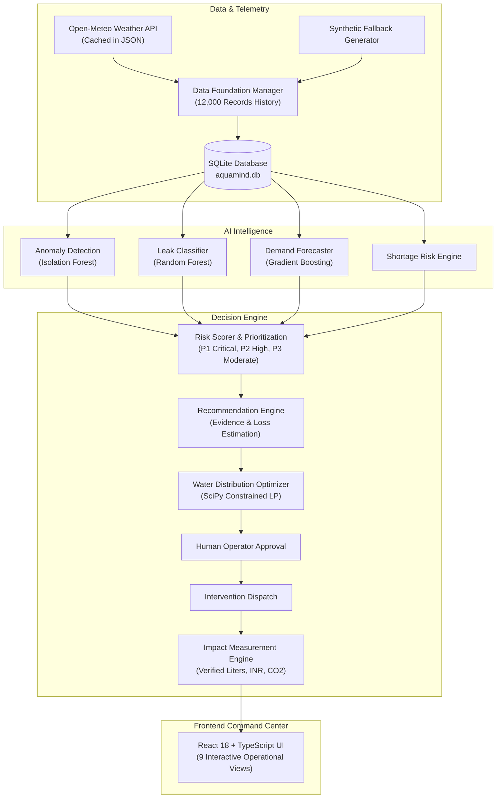

# AquaMind AI — Smart Campus Water Intelligence & Resilience Platform

**Hackathon:** TCS AI Hackathon 2026  
**Theme:** THEME 3: AI for Impact  
**Domain:** Sustainability  
**Tags:** `Artificial Intelligence`, `Water Resilience`, `Anomaly Detection`, `Leak Prediction`, `Demand Forecasting`, `Decision Intelligence`, `Optimization`  

---

## 1. Project Vision & Identity

**AquaMind AI** is an intelligent decision-support and water resilience platform engineered for educational, industrial, and municipal campuses. 

Treating the campus as a small city, AquaMind AI bridges real-time IoT hydraulic telemetry with machine learning to automate the complete resilient water lifecycle:

$$\textbf{MONITOR} \longrightarrow \textbf{DETECT} \longrightarrow \textbf{PREDICT} \longrightarrow \textbf{PRIORITIZE} \longrightarrow \textbf{OPTIMIZE} \longrightarrow \textbf{RECOMMEND} \longrightarrow \textbf{HUMAN APPROVAL} \longrightarrow \textbf{INTERVENE} \longrightarrow \textbf{MEASURE IMPACT}$$

### Core Problem It Solves
Water availability depends on volatile municipal supply, precipitation, infrastructure aging, and fluctuating human demand. Undetected underground pipe leaks silently waste tens of thousands of liters of clean water daily, cause premature tank depletions, and lead to abrupt campus-wide shutdowns.

AquaMind AI detects abnormal usage, differentiates real physical leaks from sensor telemetry glitches, forecasts building-level demand, calculates shortage risks, prioritizes critical interventions (P1/P2/P3), computes fair distribution optimizations, and verifies actual post-repair water savings.

---

## 2. Campus Topology & Building Profiles

The system models **6 distinct campus buildings/zones** fed by a **Central Campus Reservoir** (500,000 Liters / $500\text{ m}^3$ storage) and rainwater harvesting ($15,000\text{ m}^2$ roof catchment):

| Building ID | Building Name | Category | Max Occ. | Tank Cap. | Nominal Press. | Vulnerability Guardrail |
| :--- | :--- | :--- | :--- | :--- | :--- | :--- |
| `academic_block` | Academic Block | Academic | 1,200 | $45,000\text{ L}$ | $3.5\text{ bar}$ | Standard Operational |
| `hostel_a` | Hostel A | Residential | 450 | $60,000\text{ L}$ | $3.2\text{ bar}$ | **Vulnerable Population (Hostel Guardrail)** |
| `hostel_b` | Hostel B | Residential | 500 | $65,000\text{ L}$ | $3.2\text{ bar}$ | **Vulnerable Population (Hostel Guardrail)** |
| `canteen` | Canteen | Dining | 350 | $35,000\text{ L}$ | $3.4\text{ bar}$ | Essential Food Sanitation |
| `laboratory_block` | Laboratory Block | Research | 250 | $50,000\text{ L}$ | $3.8\text{ bar}$ | **Critical Lab Process Cooling** |
| `sports_garden` | Sports & Garden Area | Recreation | 150 | $40,000\text{ L}$ | $3.6\text{ bar}$ | Flexible (Irrigation Throttleable) |

---

## 3. Technology Stack & Architecture

- **Backend:** Python 3.14, FastAPI, SQLite with indexing & foreign keys, Pydantic v2 schemas.
- **Machine Learning:** Scikit-Learn (Multivariate Isolation Forest, Random Forest Classifier with balanced weights, Gradient Boosting Regressors), NumPy, Pandas, Joblib.
- **Optimization:** SciPy (`scipy.optimize.linprog` HiGHS simplex/interior-point solver) with linear fairness constraints.
- **Weather Service:** Open-Meteo Historical Archive API with disk caching and Bangalore-calibrated synthetic meteorological fallback.
- **Frontend:** React 18, TypeScript, Vite, Lucide Icons, Recharts.
- **Testing:** Pytest (32 automated unit & integration tests).



---

## 4. Summary of Completed Phases

### Phase 1 — Data Foundation
- 12,000 realistic records ($2,000\text{ hours} \times 6\text{ buildings}$) with fixed seed `42`.
- Exact schema: `timestamp`, `building`, `occupancy`, `water_consumption_liters`, `flow_rate_lpm`, `pressure_bar`, `tank_level_percent`, `night_flow_lpm`, `temperature`, `rainfall`, `humidity`, `is_weekend`, `is_holiday`, `leak_status`, `anomaly_status`.
- Resilient weather engine with local disk caching and transparent Bangalore synthetic fallback (`open_meteo` vs `synthetic_fallback`).
- Chronological train/test split without temporal leakage.

### Phase 2 — Backend & Database
- Modular FastAPI backend with 11 specialized routers.
- SQLite database (`backend/aquamind.db`) with 7 indexed tables: `buildings`, `sensor_readings`, `alerts`, `predictions`, `recommendations`, `interventions`, `impact_measurements`.
- Real-time simulator integration with `POST /api/simulator/step`, `/leak`, `/fault`, `/leak/stop`.

### Phase 3 — AI Intelligence
- **Anomaly Detection:** Multivariate Isolation Forest (150 trees, contamination=0.035) with heuristic root-cause diagnosis.
- **Leak Severity Classifier:** Supervised Random Forest Classifier predicting `none`, `minor`, `moderate`, `major` with calibrated probabilities.
- **Demand Forecaster:** Multi-building Gradient Boosting Regressors predicting 24-hour and 7-day hourly demand (MAE: 81.5 L/h).
- **Shortage Risk Engine:** Grounded storage autonomy calculations with explainable rationale.
- Models saved in `ai/saved_models/` via Joblib.

### Phase 4 — Decision Intelligence & Optimization
- **Risk Scoring:** 0-100 composite operational score mapped to `P1 — Critical`, `P2 — High`, `P3 — Moderate`.
- **Recommendation Engine:** Full lifecycle (`Detected` → `Under Review` → `Approved` → `In Progress` → `Impact Measured`) with supporting evidence, department assignments, and loss estimations.
- **Constrained Optimization:** SciPy Linear Programming protecting essential residential drinking and lab cooling floors.
- **Impact Measurement:** Post-repair verified savings calculating Liters, INR, pumping energy (kWh), and avoided CO2.
- **What-If Scenario Simulator:** Dynamic projections for leaks, 40% supply cuts, heatwaves, and rain events.

### Phase 5 — Professional Frontend
- Institutional Water Operations Command Center built in React 18, TypeScript, and Vite.
- 9 operational views: Overview, Live Monitoring, Predictions, Alerts, Recommendations, Buildings, Optimization, Analytics, Scenario Simulator.
- Live interactive buttons to trigger moderate/major leaks, sensor faults, approve actions, and dispatch maintenance.

### Phase 6 — Integration & End-to-End Testing
- 32 automated unit and integration tests passing (100%).
- Full 16-step Hostel A moderate leak demonstration script verified end-to-end.
- Production TypeScript compilation verified.

---

## 5. Startup & Execution Instructions

### A. Environment Setup
```powershell
# Install Python dependencies
python -m pip install -r requirements.txt

# Install Frontend dependencies (Node.js 18+ required)
cd frontend
npm install
cd ..
```

### B. Start Backend API Server
In a Windows PowerShell window:
```powershell
python -m uvicorn backend.main:app --host 0.0.0.0 --port 8000 --reload
```
- **Backend API URL:** `http://localhost:8000`
- **Swagger / OpenAPI Documentation:** `http://localhost:8000/docs`

### C. Start Frontend Development Server
In a second Windows PowerShell window:
```powershell
cd frontend
npm run dev
```
- **Frontend Application URL:** `http://localhost:5173`

### D. Run Automated Test Suites
```powershell
# Run all 32 automated tests
python -m pytest -v

# Run the 16-step Master Hackathon Demonstration Script
python scripts/verify_hostel_a_scenario.py
```

---

## 6. Master Hackathon Demonstration Scenario

**Scenario: Moderate Pipeline Leak in Hostel A**

1. Open `http://localhost:5173` in your browser.
2. View normal baseline campus telemetry in **Overview** (Total flow ~180 LPM, tanks ~75%).
3. Navigate to **Live Monitoring**.
4. In the simulation console, select **Hostel A** and **Moderate Leak**, then click **Trigger Physical Leak**.
5. Observe changing physical telemetry:
   - Flow rate jumps from 18.5 LPM to 38.0 LPM (+19.5 LPM discrepancy).
   - Line pressure drops from 3.03 bar to 2.33 bar.
   - Tank level starts accelerating drawdown.
6. The AI detects the anomaly and classifies the root cause as `Infrastructure Anomaly (Suspected Physical Leak)`.
7. The Leak Classifier predicts **Possible Moderate Leak — Inspection Required** with **98.9% confidence**.
8. Navigate to **Recommendations**.
9. Observe the newly generated **P1/P2 Recommendation** for Hostel A with 6 verified hydraulic evidence bullets and estimated loss of 25,920 L/day (INR 1,166/day).
10. Click **Approve Action** (Status transitions to `Approved`).
11. Click **Dispatch Maintenance (In Progress)** (Status transitions to `In Progress`, intervention `INT-...` created).
12. Click **Simulate Repair & Measure Impact**:
    - The leak is physically isolated in the simulator.
    - Status transitions to `Impact Measured`.
    - Verified impact is recorded: **25,704 Liters saved**, **INR 1,156.68 saved**, **11.57 kWh energy saved**, **9.49 kg CO2 avoided**.
13. Navigate to **Analytics** to see the permanent verified intervention record.

---

## 7. Assumptions, Known Limitations & Guardrails

1. **Lumped Building Capacitance:** Water storage is modeled as aggregate overhead tanks ($35,000\text{ L}$ to $65,000\text{ L}$) per building.
2. **Sampling Granularity:** Simulation steps at hourly intervals ($\Delta t = 1.0\text{ h}$), mirroring IoT battery conservation standards.
3. **Quasi-Steady Flow:** High-frequency water hammer shockwaves are filtered out to emphasize sustained volumetric losses.
4. **Vulnerable Population Guardrail:** Hostels A & B are designated as protected residential zones. The system **never autonomously imposes supply cuts** on vulnerable student living quarters during droughts. All consequential allocation changes remain strictly subject to authorized human approval.
