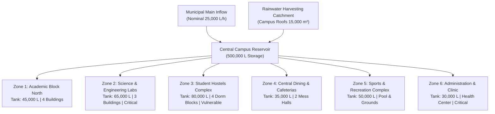
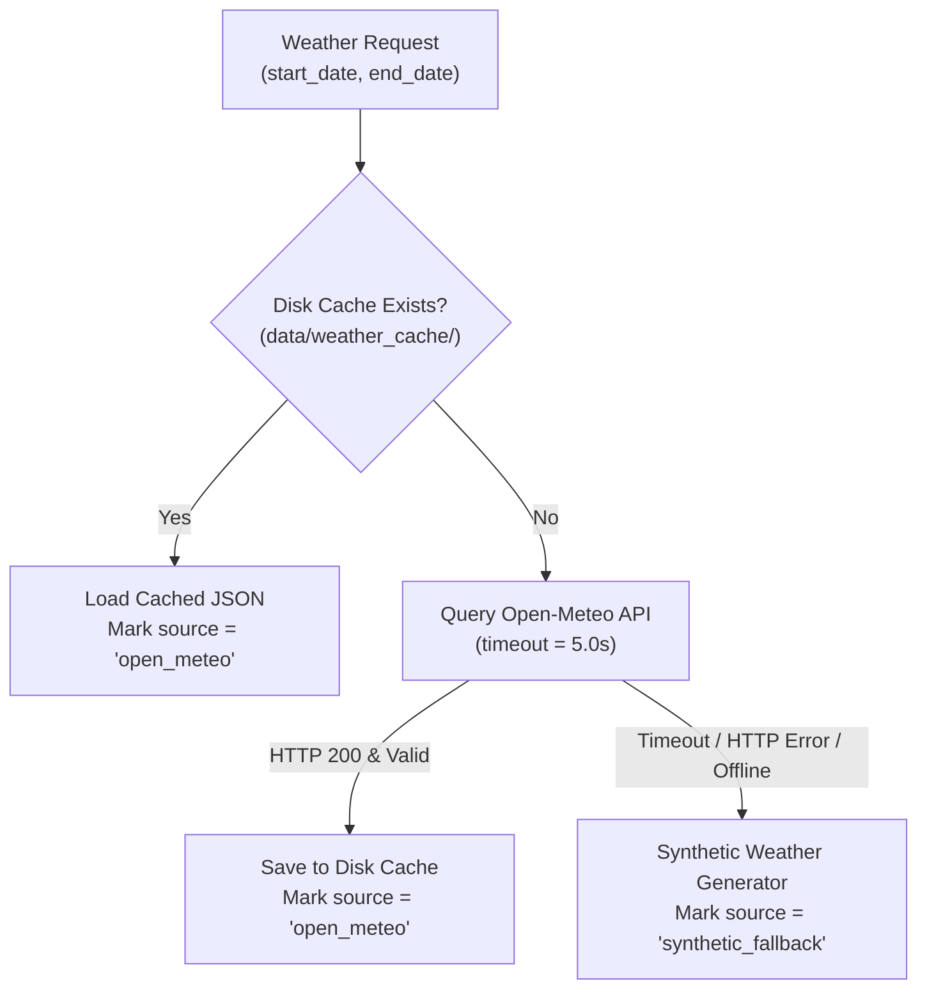

# AQUAMIND Architecture & Physical Consistency Specification (Phase 1)

## 1. Campus Topology & Zone Profiles

The campus distribution model reflects an educational and research university campus with **6 specialized operational zones** fed by a **Central Campus Reservoir** (500,000 Liters / $500\text{ m}^3$ capacity).

### Zone Parameters Summary

| Zone ID | Description | Tank Capacity | Base Active Demand | Night Idle Load | Nominal Pressure | Vulnerability Guardrail |
| :--- | :--- | :--- | :--- | :--- | :--- | :--- |
| `zone_1_academic_north` | Lecture halls, faculty offices | $45,000\text{ L}$ | $2,200\text{ L/h}$ | $120\text{ L/h}$ | $3.5\text{ bar}$ | Standard |
| `zone_2_research_labs` | Wet labs, chillers, clean rooms | $65,000\text{ L}$ | $3,800\text{ L/h}$ | $1,400\text{ L/h}$ | $3.8\text{ bar}$ | High (Cooling safety) |
| `zone_3_student_hostels` | Student dormitories (Blocks A-D)| $80,000\text{ L}$ | $4,200\text{ L/h}$ | $350\text{ L/h}$ | $3.2\text{ bar}$ | **Vulnerable Population** |
| `zone_4_dining_cafeteria`| Kitchens, dishwashing, messes | $35,000\text{ L}$ | $2,800\text{ L/h}$ | $80\text{ L/h}$ | $3.4\text{ bar}$ | Standard |
| `zone_5_sports_recreation`| Gym, pool top-up, turf irrigation | $50,000\text{ L}$ | $2,500\text{ L/h}$ | $450\text{ L/h}$ | $3.6\text{ bar}$ | Flexible (Irrigation) |
| `zone_6_admin_facilities`| Admin HQ, library, campus clinic | $30,000\text{ L}$ | $1,500\text{ L/h}$ | $90\text{ L/h}$ | $3.3\text{ bar}$ | **Critical Clinic** |

---

## 2. Mathematical Mass Balance & Physical Continuity

### 2.1 Zone Storage Mass Balance
At each discrete time interval $\Delta t = 1.0\text{ hour}$:

$$\Delta V_{\text{zone}}(t) = \left[ Q_{\text{inlet}}(t) - Q_{\text{outlet}}(t) \right] \cdot \Delta t$$

$$V_{\text{zone}}(t) = \text{clip}\left( V_{\text{zone}}(t-1) + \Delta V_{\text{zone}}(t),\; 0,\; \text{Capacity}_{\text{zone}} \right)$$

$$\text{tank\_level\_pct}(t) = \frac{V_{\text{zone}}(t)}{\text{Capacity}_{\text{zone}}} \times 100\%$$

### 2.2 Pipe Flow vs Internal Sub-Meters
The system maintains mathematical consistency between bulk pipeline flow and distributed building consumption:

$$Q_{\text{outlet}}(t) = Q_{\text{consumption}}(t) + Q_{\text{leak}}(t)$$

- **Smart Sub-Meters:** Measure $Q_{\text{consumption}}(t) + \epsilon_{\text{submeter}}$
- **Main Line Flow Sensor:** Measures $Q_{\text{outlet}}(t) + \epsilon_{\text{pipe}}$
- **Physical Discrepancy Equation:**
  $$\Delta Q_{\text{observed}} = Q_{\text{outlet}} - Q_{\text{consumption}} = Q_{\text{leak}} + (\epsilon_{\text{pipe}} - \epsilon_{\text{submeter}})$$

### 2.3 Booster Pump Control with Hysteresis
To prevent rapid motor cycling:
$$\text{PumpState}(t) = \begin{cases} 
1 & \text{if } \text{tank\_level} \le 25.0\% \\
0 & \text{if } \text{tank\_level} \ge 95.0\% \\
\text{PumpState}(t-1) & \text{otherwise}
\end{cases}$$

---

## 3. Weather Service & Resilient Fallback Architecture

External weather queries are routed through a multi-tiered resilience pipeline:

> [!NOTE]
> Synthetic weather implements seasonal monsoon curves, diurnal solar cycles, and Bangalore meteorological distributions. Source attribution is strictly recorded in every row.

---

## 4. ML Data Leakage Prevention

1. **Physical Feature Decoupling:**
   - Features in `historical_sensor_readings.csv` are strictly observable in real time.
   - Ground truth labels in `ground_truth_labels.csv` contain physical root causes and actual leak discharge rates.
2. **Automated Column Auditing:**
   - The validation engine (`src/validation/validator.py`) and splitting utility (`src/data/splitter.py`) automatically detect and reject any ground-truth column present in training matrices.

